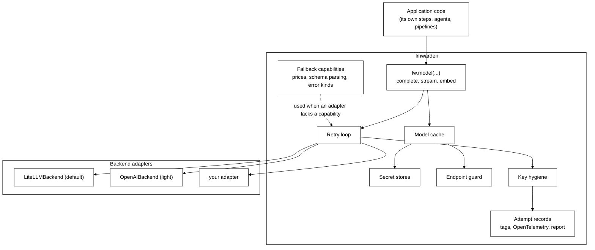
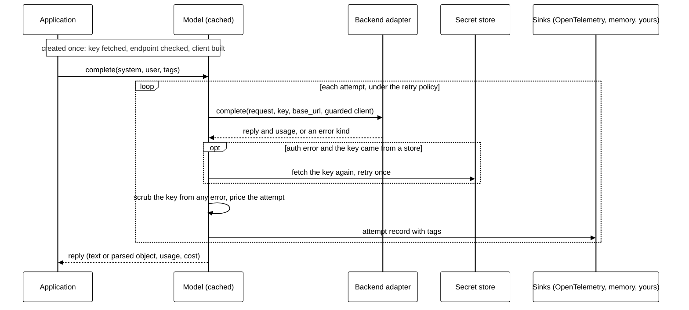

# llmwarden architecture

> **Status: proposal.** This describes the design before any code is written. Every claim about LiteLLM and the openai SDK below was checked against their source code and small probes with mocked HTTP. The versions are listed under [Evidence](#evidence).

## Goals

- Create a model in code with its key, from a plain string, a function or a secret store, and call it.
- Fetch keys once, cache the client, and handle key rotation without a restart.
- Make custom endpoints safe on hosted apps.
- Never let a key reach a traceback, a log or an application hook.
- Record every attempt, retries included, with tokens, cost, outcome and the caller's tags, and emit it as OpenTelemetry.
- Return structured output as validated Pydantic objects, and stream, the same on every provider.
- **Rebuild nothing the backend already does well.** Where a backend provides a capability, llmwarden uses it. Where it does not, llmwarden supplies its own.

## Scope

**In:** models created with a key; secret stores; client caching and rotation; the endpoint guard; key hygiene; `complete`, `stream` and `embed` with async versions; retries and a fallback model; tags, attempt records, OpenTelemetry spans and a simple report.

**Out, and left to the application:**
- Stages, agents, steps and pipelines, and which model each one uses.
- Config files. An application that wants one builds models from its own config.
- Deciding whether a request succeeded, budgets, and where records are stored.
- Dashboards. OpenTelemetry tools already provide them.
- Running as a proxy or gateway server, and load balancing across providers or keys.

## Using it

```python
import llmwarden as lw

# At startup: register the secret stores in use (env is built in).
lw.secrets.use(lw.stores.AwsSecrets(region="us-east-1"))

# Create models. The key is resolved and the client built here, then cached.
fast = lw.model("groq/llama-3.3-70b-versatile",
                api_key=lw.secret(store="aws", name="prod/llm", field="groq_key"))
strong = lw.model("anthropic/claude-sonnet-5-5",
                  api_key=lw.secret(store="env", name="ANTHROPIC_API_KEY"),
                  fallback=fast)
local = lw.model("openai_compatible/qwen3",
                 base_url="https://models.example.com/v1",
                 public_only=True)

# Call them, with tags for attribution.
with lw.tags(request="q-1842", customer="acme"):
    better = fast.complete(system="Rewrite the question.", user=q, tags={"step": "rewrite"})
    ranking = strong.complete(system=..., user=..., schema=Ranking, tags={"step": "rerank"})
    for chunk in strong.stream(system=..., user=..., tags={"step": "answer"}):
        print(chunk.text, end="")

lw.report(group_by=["customer", "step"])
```

## The model

`lw.model(name, *, api_key=None, base_url=None, public_only=False, params=None, price=None, retry=None, fallback=None, backend=None)`

| Argument | Meaning |
|---|---|
| `name` | `provider/model`, for example `openai/gpt-5.4` or `groq/llama-3.3-70b-versatile`. llmwarden owns this format, and each backend translates it. It matches LiteLLM's, so that backend passes it straight through. |
| `api_key` | A plain string, a function that returns a string, or `lw.secret(...)`. Omitted: the provider's standard variable through `env`, such as `OPENAI_API_KEY`. |
| `base_url` | Optional. Any OpenAI-compatible server. Checked by the endpoint guard. |
| `public_only` | Turns the endpoint guard on. For hosted apps that strangers use. |
| `params` | Default model parameters: `temperature`, `max_tokens` and so on. Any call can override them. |
| `price` | Optional price per million input and output tokens, for this model only. |
| `retry` | Optional retry policy (see Retries). |
| `fallback` | Optional model to move to after the retries fail. |
| `backend` | Optional backend adapter. Default: `LiteLLMBackend()`. |

**Creating a model** checks the name against the backend's providers, resolves the key, runs the endpoint guard and builds the client. A model that cannot work fails here, at startup, not during a request.

**Caching.** Models are cached by name, key source, base URL and backend. Calling `lw.model(...)` again with the same arguments returns the cached model, with no new key fetch and no new client. The key source is compared by reference (the store, name and field), never by the key's value.

**Rotation.**
- `model.refresh()` fetches the key again and rebuilds the client.
- `lw.clear_cache()` drops every cached model and key.
- `lw.secret(..., ttl=3600)` re-fetches the key after an hour, on the next call.
- **Automatic:** if a call fails with an authentication error and the key came from a store or a function, llmwarden fetches the key once more and retries once. A rotated key then works without a restart. A plain-string key is never retried this way.

## Secret stores

`lw.secret(store, name, field=None, ttl=None)`

| Store | `name` | Example |
|---|---|---|
| `env` (built in) | The environment variable | `lw.secret("env", "GROQ_API_KEY")` |
| `aws` (Secrets Manager) | The secret's name or ARN | `lw.secret("aws", "prod/llm", field="groq_key")` |
| `azure` (Key Vault) | The secret's name in the vault | `lw.secret("azure", "groq-api-key")` |
| `vault` (HashiCorp) | The path to the secret | `lw.secret("vault", "secret/data/llm/groq", field="key")` |
| `gcp` (Secret Manager) | The secret's name, optionally with a version | `lw.secret("gcp", "groq-key/versions/latest")` |

- `field` picks one value when the secret holds JSON with several.
- Where a store lives (its region, vault URL, address or token) is set once, when it is registered with `lw.secrets.use(...)`. Each `lw.secret(...)` then only names the secret.
- `env` needs no setup and can read a `.env` file if given one.
- `aws`, `azure`, `vault` and `gcp` ship as extras, so their SDKs are installed only when used.
- A store of your own is one class:

```python
class SecretStore(Protocol):
    id: str
    def get(self, name: str) -> str: ...
```

- A `lw.secret(...)` is an explicit object, never a `"${...}"` string, so a real key can never be mistaken for a reference.
- Fetched keys are held in memory only, never written to disk, logs or errors.

**Why not LiteLLM's.** LiteLLM has secret manager integrations, but in its SDK they do not fit: Google, HashiCorp and CyberArk need its enterprise licence, the Azure Key Vault loader lives in its proxy, the AWS one works through global state, and `os.environ/` references are read only in Router config.

## The backend facade

Every model calls through one **backend adapter**, which wraps a provider library.



### The adapter interface

Every adapter implements the same small interface and declares what its library can do.

```python
@dataclass(frozen=True)
class Capabilities:
    providers: frozenset[str]   # providers this adapter can reach
    prices: bool                # can price a call itself
    schema: bool                # can ask the provider for schema-shaped JSON
    stream_usage: bool          # reports usage at the end of a stream
    http_client: bool           # accepts an injected httpx client per call
    embeddings: bool

class Backend(Protocol):
    capabilities: Capabilities

    def complete(self, request: ChatRequest, call: CallContext) -> ChatReply: ...
    def stream(self, request: ChatRequest, call: CallContext) -> Iterator[ChatChunk]: ...
    def embed(self, request: EmbedRequest, call: CallContext) -> EmbedReply: ...
    def error_kind(self, error: BaseException) -> ErrorKind: ...
    def price(self, reply: ChatReply | EmbedReply) -> Cost | None: ...   # used only if capabilities.prices
```

- `CallContext` carries what llmwarden resolved: the key, the base URL, and, when the endpoint guard is on, the httpx client to use.
- Async versions (`acomplete`, `astream`, `aembed`) follow the same pattern.
- Every adapter has its own **constructor**, which takes that library's options, so an application can tune the library without llmwarden knowing every option: `LiteLLMBackend(drop_params=False)`, `OpenAIBackend(timeout=30)`.

### The rule: use the backend's, else ours

For each capability, llmwarden asks the adapter first. If the adapter's library provides it, the adapter hands it through. If not, llmwarden's own version fills in.

| Capability | LiteLLMBackend | OpenAIBackend | llmwarden supplies |
|---|---|---|---|
| Reach many providers | **Uses LiteLLM** (165 providers, `provider/model` names, `get_llm_provider`) | One: any OpenAI-compatible server | Nothing |
| Per-call key and base URL | **Uses LiteLLM** (`api_key`, `api_base` per call) | **Uses the SDK** (`api_key`, `base_url` on the client) | Nothing |
| Error kinds | **Uses LiteLLM's mapping** (every provider's errors mapped to one set, such as `RateLimitError` and `Timeout`), translated to ours with a small table | Maps the SDK's exception classes | The `ErrorKind` list the retry policy reads |
| Price of a call | **Uses LiteLLM** (`response_cost`, `completion_cost`, embeddings too) | None | A price table, used when the adapter has none or a model sets its own price |
| Schema-shaped JSON from the provider | **Uses LiteLLM** (`response_format` takes a Pydantic class; `supports_response_schema`) | **Uses the SDK** (`chat.completions.parse` returns a parsed object) | Validation into the Pydantic class, always; a schema in the prompt for providers without support |
| Usage at the end of a stream | **Uses LiteLLM**, with `include_usage` always sent | **Uses the SDK** (`stream_options={"include_usage": True}`) | A flag when tokens were estimated, not reported |
| Injected HTTP client | **Uses LiteLLM** (`client=` per call; works on the OpenAI and Anthropic paths, other providers to be tested one by one) | **Uses the SDK** (`http_client=`) | The guarded client itself |
| Retries | Not used: LiteLLM's retries hide failed attempts (see Retries) | Not used: turned off with `max_retries=0` | The retry loop |
| Secret stores | Not used (see Secret stores) | n/a | The secret stores |
| Guard for custom endpoints | Not used: LiteLLM checks `api_base` only in its proxy | n/a | The endpoint guard |
| Key scrubbing | Not enough: LiteLLM callbacks receive the raw key | Not enough: SDK errors hold the key in `request.headers` | Key hygiene |
| Attempt records and tags | LiteLLM callbacks miss retried attempts and carry the raw key | n/a | Records, tags, OpenTelemetry spans and reports |

## Endpoint guard

Runs when a model is created with a `base_url` and `public_only=True`, and again on every call.

1. The scheme must be `https`.
2. The URL must have no user info, no fragment and no query string.
3. The host is resolved, and every address must be public. Private ranges, loopback, link-local, multicast, reserved ranges and cloud metadata addresses are refused.
4. llmwarden builds an httpx client with **redirects off** and a transport that connects only to the address it checked, while keeping the real host name for TLS and the `Host` header. A DNS change between check and call cannot reach a private address.
5. That client is handed to the adapter through `CallContext`. LiteLLM takes it as `client=` and the openai SDK as `http_client=`. LiteLLM's async default transport is aiohttp, so the LiteLLM adapter sets `disable_aiohttp_transport` to keep the call on the guarded httpx client.

An adapter whose `capabilities.http_client` is false cannot pin the address. With `public_only=True`, llmwarden refuses custom endpoints on that adapter rather than run them unguarded.

**Why not LiteLLM's.** LiteLLM's SDK never checks `api_base`. Its proxy does, and its `validate_url` helper guards image and file URLs. That helper is a useful reference, but it rewrites the URL to the IP, which breaks TLS host checks for https, so llmwarden pins the address in the transport instead.

With `public_only` off, as on a developer's own machine, local servers such as Ollama on `localhost` work.

## Key hygiene

- The resolved key goes to the adapter call and nowhere else.
- Any exception from the adapter is caught, its message scrubbed of the key, and re-raised as `ProviderError` with `from None`. The original is dropped because it can hold the key: the openai SDK's errors keep the real request, with the key in `request.headers`.
- llmwarden never registers LiteLLM callbacks and never passes their arguments on, because LiteLLM hands callbacks the raw key. Applications get llmwarden's own records and spans, which hold no key.
- `repr` and `str` of a model mask the key and show a secret reference as its store and name.
- A logging filter is provided that scrubs any fetched key from log records.

## Structured output

```python
class Ranking(BaseModel):
    order: list[int]

reply = strong.complete(system=..., user=..., schema=Ranking)
reply.parsed      # a Ranking
reply.text        # the raw JSON the model returned
```

- If the adapter has `capabilities.schema`, the schema goes to the provider: LiteLLM's `response_format` takes the Pydantic class, and the openai SDK's `chat.completions.parse` takes it too.
- **llmwarden always validates the reply itself** with `model_validate_json`. LiteLLM returns a JSON string, not an object. For a provider without schema support, LiteLLM either raises or, with `drop_params=True`, silently drops the schema, so the LiteLLM adapter never sets `drop_params`. For such providers, llmwarden describes the schema in the prompt instead.
- A reply that fails validation can be retried. If every attempt fails, `complete` raises `InvalidOutput` with the last raw text attached.

## Streaming

```python
for chunk in strong.stream(system=..., user=...):
    print(chunk.text, end="")
reply = chunk.final   # on the last chunk: full text, usage and cost
```

- Async: `astream`.
- `include_usage` is always sent. LiteLLM adds it on its own only for OpenAI's own endpoint, not for a custom base URL.
- When a provider reports no usage, LiteLLM estimates the tokens. llmwarden marks such usage as `estimated`, so a record never presents a guess as a count.
- `schema` is not accepted with `stream`. Structured output is validated on the whole reply.

## Retries

llmwarden runs retries itself, and the adapters turn every hidden retry off, so **every attempt is seen and recorded**. LiteLLM's own retries cannot be used for this:

- With `num_retries=2`, a probe made five HTTP attempts but LiteLLM reported one failure. When the first attempt failed and the second worked, it reported one success and no failure at all.
- Its retries rely on `tenacity`, which is not installed with LiteLLM. Without it, a sync call raises and an async call silently skips the retry.
- For OpenAI-based providers, LiteLLM and the openai SDK both retry twice by default, silently. The adapters always pass `max_retries=0`.

LiteLLM's Router does report each attempt, but it brings a large amount of machinery (deployments, cooldowns, caches) for one feature. A small loop is simpler.

A retry policy says how many attempts, which `ErrorKind`s to retry (rate limit, timeout, server error, invalid output), and the wait between attempts. When the retries run out, a model with a `fallback` moves to that model, which has its own key, endpoint and retry policy.

## Observability

### Tags

```python
with lw.tags(request="q-1842", customer="acme"):
    plan = planner.complete(..., tags={"agent": "planner"})
```

- `lw.tags(...)` sets tags for everything inside it, however deep, through a context variable, so it works across function calls, threads started inside it, and async tasks.
- Per-call `tags=` add to them, and win on a clash.
- Tags are plain strings. llmwarden gives no tag a special meaning.

### Attempt records

Every attempt is one record:

| Field | Meaning |
|---|---|
| `id`, `call_id` | This attempt, and the call it belongs to |
| `model`, `provider` | The model actually called, which differs from the one asked for after a fallback |
| `attempt` | 1 for the first try, 2 for the first retry, and so on |
| `outcome` | `ok`, `provider_error`, `invalid_output` or `cancelled` |
| `error_kind` | On failure: `rate_limit`, `timeout`, `auth`, `server`, `bad_request` and so on |
| `input_tokens`, `output_tokens` | As reported, or `None` |
| `usage_source` | `reported` or `estimated` |
| `cost` | From the price source, or `None` when a count or price is unknown |
| `price_source` | `model`, `backend` or `llmwarden` |
| `started`, `seconds` | When the attempt started, and how long it took |
| `tags` | All tags in effect |

Records are handed to every registered sink. Three ship with llmwarden:

- **OpenTelemetry.** One span per attempt, using the OpenTelemetry GenAI attribute names (`gen_ai.system`, `gen_ai.request.model`, `gen_ai.usage.input_tokens`, `gen_ai.usage.output_tokens` and so on), with llmwarden's fields and the tags as further attributes. Any OpenTelemetry tool can then show them. The GenAI conventions are still marked as in development, so the attribute names are pinned to one version and listed in the docs. Installed as `llmwarden[otel]`.
- **In memory.** Keeps the latest records, with a size limit, for `lw.report`.
- **A function.** `lw.observe.add(my_sink)` calls your function with each record, for your own database, log or billing system.

### Reports

```python
lw.report(group_by=["customer", "agent"], since=...)
```

For each group: calls, attempts, failures by `error_kind`, tokens, total cost, cost wasted on failed attempts that still used tokens, attempts whose cost is unknown, and time. It reads the in-memory sink. Anything larger belongs in an OpenTelemetry tool.

### Privacy

- Prompts and replies are not recorded unless `lw.observe.capture_content(True)` is set.
- Keys are never recorded, in any mode.

### Prices

In this order:
1. The model's own `price`, applied by llmwarden to that model only. It is never registered in LiteLLM, because LiteLLM's per-call prices are stored globally and leak into later calls to the same model.
2. The adapter's price, when it has one. For LiteLLM, `response_cost`. It is `None` for a model LiteLLM does not know, and llmwarden keeps it as unknown.
3. llmwarden's own table, for adapters without prices. It starts as a copy of LiteLLM's price file (MIT), with credit and the date it was taken.

The LiteLLM adapter sets `LITELLM_LOCAL_MODEL_COST_MAP=True`, so LiteLLM uses the price file inside the installed package and does not download one from GitHub when it is imported.

## One call, step by step



## Swapping the backend

The interface is kept small so that a new adapter is one file. Six things stay on llmwarden's side, so a swap does not leak:

1. **Model names.** llmwarden owns `provider/model`, and each adapter translates it.
2. **Prices.** llmwarden owns the price order above, so an adapter without prices still gets costs.
3. **Errors.** Each adapter maps its library's exceptions to `ErrorKind`. Retries and records read only `ErrorKind`.
4. **Provider coverage.** Each adapter declares its providers, and `lw.model(...)` checks against them.
5. **The guarded HTTP client.** llmwarden builds it, and the adapter only accepts it. An adapter that cannot accept one gets no custom endpoints under `public_only`.
6. **Provider-specific features.** Some features, such as Claude's native citations, need request shapes a general adapter does not pass. These go through one marked escape hatch (see Open questions), so the normal path stays swappable.

**Two adapters from the first version.** `LiteLLMBackend` is the default. `OpenAIBackend` is a light adapter for any OpenAI-compatible server, built on the official `openai` SDK, for people who do not want LiteLLM's dependencies. The same contract tests run against both. With only one adapter, the interface would quietly come to depend on it.

**Writing your own adapter.** Implement `Backend`, declare its `Capabilities`, and pass it as `backend=`. Run llmwarden's contract test suite against it. Anything your library does not provide, leave out of `Capabilities`, and llmwarden supplies its own.

## Threats and how they are handled

| Threat | Handling |
|---|---|
| A key written into code or config | Keys can come from a store or a function. A plain-string key works for local use, and is masked when a model is printed. |
| A user-supplied base URL reaches an internal service | Endpoint guard with `public_only`: https, public addresses only, the checked address pinned in the transport, no redirects. |
| A key appears in a traceback or log | Errors re-raised scrubbed with the original dropped, since SDK errors hold the request headers; logging filter. |
| A key reaches an application hook | LiteLLM callbacks are never registered or forwarded. llmwarden's records and spans carry no key. |
| A key sent to the wrong server | The key goes only to its own model's call. A custom endpoint with no key gets a placeholder, so an SDK never falls back to an environment key and sends it elsewhere. |
| A rotated key breaks a running app | One automatic re-fetch on an auth error, `refresh()`, and `ttl`. |
| Hidden retries cost money no report shows | Every library retry turned off; llmwarden's loop records each attempt. |
| Prompts with personal data end up in traces | Content is not recorded unless turned on. |
| A compromised or changed backend release | The backend is an extra pinned to an exact version and can be swapped. LiteLLM's price file is read from the package, not downloaded at import. |

## How the first two projects adopt it

- **RAG Playground (Pandion).** Each LLM step builds its model with `lw.model(...)` from its own settings, and tags its calls with the step and run. Pandion's own provider list, key handling and endpoint guard are removed, and its Speed and cost feature reads llmwarden's records. Embedding can then use API models, not only local ones.
- **nl2sql.** Each agent builds its model from nl2sql's existing config. Its secret providers move into llmwarden stores. Because nl2sql runs on LangChain, llmwarden ships a small adapter, `llmwarden[langchain]`, that wraps a model as a LangChain chat model, keeping llmwarden's records and tags.

## Open questions

1. **Provider-specific features.** Should a model be able to hand out the raw provider client, with the key still resolved and the endpoint still guarded? This is what Claude's native citations would need.
2. **First version scope.** `complete` with `schema`, records, tags and the in-memory report first, then `stream`, async, and the OpenTelemetry sink? Or all together?
3. **Default key lifetime.** No `ttl` (keep until `refresh()` or an auth error) as the default, or a default `ttl`?

## Evidence

- **LiteLLM source:** commit `452ee4dc` on `main` (version 1.107.0 in `pyproject.toml`). LiteLLM is MIT licensed, except its `enterprise/` folder, which llmwarden does not use. The price file `model_prices_and_context_window.json` is MIT.
- **Probes:** litellm 1.105.1 (latest on PyPI at the time) and openai 2.54.0, with mocked HTTP only.
- **Main references:**
  - Error mapping: `litellm_core_utils/exception_mapping_utils.py:exception_type`.
  - Retries hiding attempts: `utils.py:client.wrapper` and `main.py:completion_with_retries`.
  - Cost: `cost_calculator.py:completion_cost` and `response_cost`.
  - Structured output: `utils.py:get_optional_params` and `supports_response_schema`.
  - Stream usage: `llms/openai/openai.py:get_stream_options`.
  - Injected client: `main.py:completion` (`client=`) and `custom_httpx/http_handler.py`.
  - `api_base` checked only in the proxy: `proxy/auth/auth_utils.py:check_complete_credentials`.
  - Raw key in callbacks: `litellm_logging.py:Logging._pre_call`.
  - The openai SDK: `_client.py:OpenAI.__init__`, `chat.completions.parse`, and `_exceptions.py:APIStatusError`.
