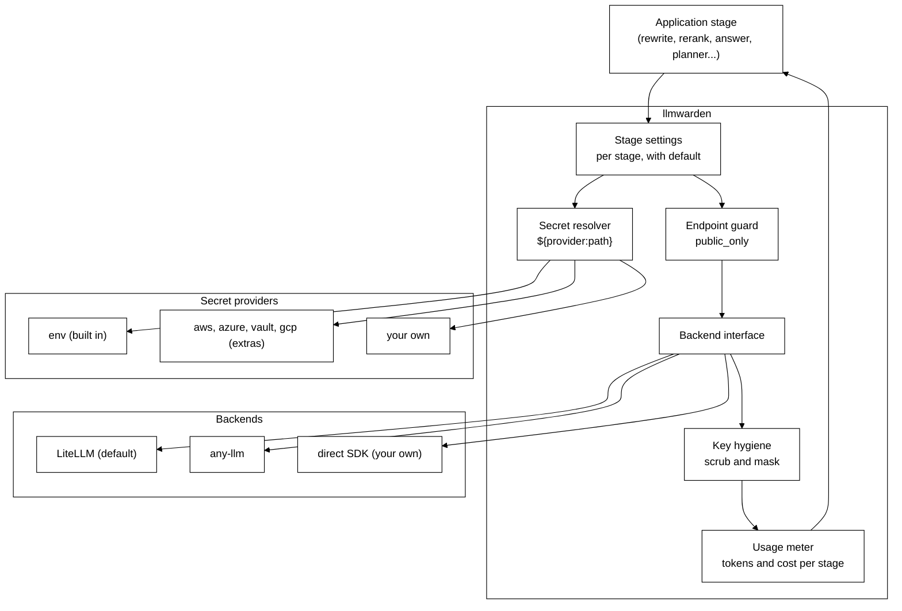
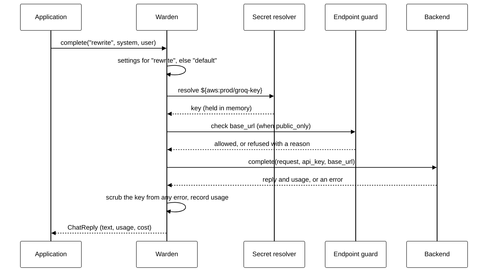

# llmwarden architecture

> **Status: proposal.** This describes the design before any code is written.

## Goals

- One place where an application states, for each stage, which model, provider, key and endpoint it uses.
- Secrets fetched by reference from any store, never written into config, logs or errors.
- Safe custom endpoints on hosted apps.
- Usage and cost per stage.
- Provider calls delegated to an existing multi-provider library, which can be swapped.

## Non-goals

- Writing a client for each provider.
- Running as a proxy or gateway server.
- Deciding what an application's stages are or how they run.
- Retries, fallbacks and load balancing across providers. The backend library may offer these; llmwarden does not add its own.

## Components



### Stage settings

Loaded from YAML or built in Python. Each stage has:

| Field | Meaning |
|---|---|
| `model` | `provider/model`, for example `openai/gpt-5.4` or `groq/llama-3.3-70b-versatile` |
| `api_key` | A secret reference such as `${env:GROQ_KEY}`. A literal key is allowed for local use and is masked when printed. |
| `base_url` | Optional. Any OpenAI-compatible server. Checked by the endpoint guard. |
| `params` | Optional model parameters: `temperature`, `max_tokens` and so on. |
| `price` | Optional price override per million input and output tokens. |

A stage with no entry, or an empty one, uses `default`. A stage that names no key uses the provider's standard variable through `env`, such as `OPENAI_API_KEY`.

Settings are frozen once built. Changing them builds a new `Warden`, so a run in progress never mixes two sets of settings.

### Secret resolver

A reference has the form `${provider:path}`. The resolver looks up the provider by id and asks it for the value.

```python
class SecretProvider(Protocol):
    id: str
    def get(self, path: str) -> str: ...
```

- `env` is built in and reserved. It reads the process environment and, if given, a `.env` file.
- `aws`, `azure`, `vault` and `gcp` ship as extras, so their SDKs are installed only when used.
- An application registers its own with `warden.secrets.register(MyProvider())`.

Values are resolved lazily, when a stage is first called, and held in memory for a configurable time (default: the life of the process). They are never cached to disk.

### Endpoint guard

Runs before any client is built, whenever a stage has a `base_url` and `public_only` is on.

1. The scheme must be `https`.
2. The URL must have no user info, no fragment and no query string.
3. The host is resolved, and every address must be public. Private ranges, loopback, link-local, multicast, reserved ranges and cloud metadata addresses are refused.
4. The client is built with redirects turned off.
5. The resolved address is pinned for the request where the backend allows it, so a DNS change between check and call cannot reach a private address. Where the backend does not allow it, this limit is documented.

With `public_only` off, as for a developer's own machine, local servers such as Ollama on `localhost` work.

### Backend interface

The only place a provider is called. Small on purpose, so a new backend is one file.

```python
class Backend(Protocol):
    def complete(self, request: ChatRequest, *, api_key: str | None,
                 base_url: str | None) -> ChatReply: ...
    def embed(self, request: EmbedRequest, *, api_key: str | None,
              base_url: str | None) -> EmbedReply: ...
```

`ChatReply` and `EmbedReply` carry the text or vectors, the stop reason, and usage as `input_tokens` and `output_tokens`, each `None` when the provider did not report it.

**Default backend: LiteLLM.** It already covers more than 100 providers, including Azure OpenAI, Bedrock, Vertex, Gemini, Groq, Mistral and any OpenAI-compatible server, and it accepts a key and base URL on every call, which is what per-stage keys need.

- It is an extra, `llmwarden[litellm]`, pinned to an exact version. Upgrades are deliberate, because a heavy dependency that releases often is a supply-chain risk.
- Its price table is used for cost when no `price` override is set.

**Other backends.** `any-llm` (lighter, built on each provider's official SDK) and a direct-SDK backend that an application writes itself. Choosing one is one line:

```python
warden = Warden.from_yaml("models.yaml", backend="any-llm")
```

### Key hygiene

- The resolved key goes to the backend call and nowhere else. It is not stored on the stage settings.
- Any exception from the backend is caught, its message scrubbed of the key, and re-raised as `ProviderError` with `from None`, so the original exception, which holds the request, is dropped.
- `repr` and `str` of settings mask literal keys and show references as written.
- A logging filter is provided that scrubs any resolved secret from log records.

### Usage meter

Each call records the stage, model, token counts and cost. `warden.usage.by_stage()` sums them. An unknown count or price stays `None` and is shown as unknown, never as zero.

## One call, step by step



## Threats and how they are handled

| Threat | Handling |
|---|---|
| A key committed in a config file | Configs hold references. Literal keys are allowed only for local use and are masked when printed. |
| A user-supplied base URL reaches an internal service | Endpoint guard with `public_only`: https, public addresses only, no redirects, address pinned where possible. |
| A key appears in a traceback or log | Errors re-raised scrubbed with the chain dropped; logging filter. |
| A key sent to the wrong server | The key goes only to its own stage's call. A custom endpoint with no key gets a placeholder, so an SDK never falls back to an environment key and sends it elsewhere. |
| A compromised backend release | The backend is an extra pinned to an exact version and can be swapped. |

## How the first two projects adopt it

- **RAG Playground (Pandion).** The rewrite, rerank and answer steps call `warden.complete` with their step name. Pandion's own provider list, key handling and endpoint guard are removed. Embedding can then use API models, not only local ones.
- **nl2sql.** Each agent maps to a stage. Its secret providers move into llmwarden. Because nl2sql runs on LangChain, llmwarden ships a small adapter, `llmwarden[langchain]`, that returns a LangChain chat model for a stage.

## Open questions

1. **Provider-specific features.** Some features, such as Claude's native citations, need request shapes that a general backend may not pass through. Should a stage be able to ask for the raw provider client, with the key still resolved and guarded by llmwarden?
2. **Streaming and async.** Both are needed eventually. Should the first version include them, or ship sync only?
3. **Price table.** Use the backend's table only, or keep a small table of our own with an "as of" date?
4. **Secret cache lifetime.** Is the life of the process the right default, or should keys expire, for rotation?
