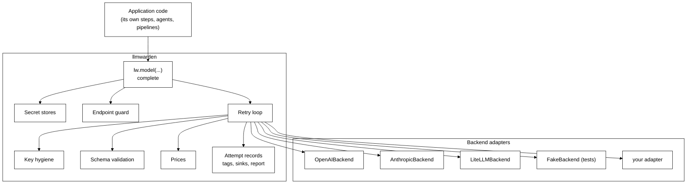

# llmwarden architecture

> **Status: version one implemented, 2026-10-15.** This document is the design the code follows. The earlier proposal's findings about LiteLLM and the openai SDK are kept under [Evidence](#evidence). Working rules for contributors are in [contributing.md](contributing.md); what shipped is in the [CHANGELOG](../CHANGELOG.md).

## Purpose

One Python package that every application uses to call language models. A backend library does the provider work behind a small adapter. llmwarden adds what no library ships: keys from real secret stores, a guard for user-supplied endpoints, key hygiene, retries that are recorded, and cost attribution by tag. Every backend behaves the same, so the backend can be swapped.

## Decisions

| Topic | Decision |
|---|---|
| Name and distribution | `llmwarden` on PyPI. Import alias `lw`. MIT. |
| Python | 3.12 and up. |
| Backends in version one | `OpenAIBackend` (OpenAI, OpenRouter, Ollama, vLLM, any OpenAI-compatible server), `AnthropicBackend`, `LiteLLMBackend`. The two native adapters prove the swap with real differences between them. LiteLLM gives breadth. No LangChain adapter. |
| Core structure | Thin adapters. An adapter translates requests, replies and errors and declares capabilities. llmwarden owns retries, records, scrubbing, schema validation, pricing and tags. |
| Secret stores | `env` built in. AWS Secrets Manager, Azure Key Vault, Google Secret Manager and HashiCorp Vault as optional extras, all in version one, built after the core. |
| Request shape | A list of messages, with `system` and `user` as sugar for the common case. Optional Pydantic `schema`. A `tools` field is reserved and rejected until implemented. |
| Keys per request | Creating a model with a plain-string key is cheap and leaks nothing, because the HTTP client is shared per backend. Bring-your-own-key hosting is a first-class use. |
| Sync first | `complete` only. Streaming, async and embeddings follow in a later version as new protocol methods with capability flags. |
| Applications | Existing applications adopt the package after version one ships. They do not shape version one beyond the requirements below. |

### Requirements that shaped version one

- A hosted application where each end user supplies their own key per request, and types a custom endpoint that must be guarded with `public_only`.
- An application that uses Anthropic beta features (adaptive thinking, server-side fallbacks). The Anthropic adapter passes unknown provider parameters through `params` untouched.
- A multi-agent pipeline that needs structured output into Pydantic classes, synchronously, without tool calling or streaming.
- CPython 3.12 and 3.13.

## Scope of version one

**In:** `lw.model`, `Model.complete`, messages and schema, retries and fallback, secret references and the five stores, the endpoint guard, key hygiene, tags, attempt records, the in-memory sink, the function sink, the OpenTelemetry sink, `lw.report`, the three backends, the contract test suite, a `FakeBackend` for applications' own tests.

**Out, and left to the application or a later version:** streaming, async, embeddings, tool calling, config files, budgets, dashboards, a proxy server, load balancing, a LangChain adapter, a LiteLLM-sized price table.

## Using it

```python
import llmwarden as lw

lw.secrets.use(lw.stores.AwsSecrets(region="us-east-1"))  # optional, at startup

m = lw.model(
    "anthropic/claude-sonnet-5-5",
    api_key=lw.secret("aws", "prod/llm", field="anthropic"),
    params={"max_tokens": 1024},
    retry=lw.Retry(attempts=3),
    fallback=lw.model("openai/gpt-5.4"),
)

with lw.tags(request="q-1842", customer="acme"):
    reply = m.complete(system="Rank these.", user=text, schema=Ranking, tags={"step": "rerank"})

reply.parsed  # Ranking
reply.text  # raw text
reply.usage  # Usage(input_tokens, output_tokens, source)
reply.cost  # Cost(usd, source) or None
reply.attempts  # 2, when the first attempt was retried

lw.report(group_by=["customer", "step"])
lw.observe.add(my_sink)  # def my_sink(record: AttemptRecord) -> None
```

## The public API

### `lw.model(...)`

```python
def model(name: str, *,
          api_key: str | Callable[[], str] | SecretRef | None = None,
          base_url: str | None = None,
          public_only: bool = False,
          params: dict[str, Any] | None = None,
          price: Price | None = None,
          retry: Retry | None = None,
          fallback: Model | None = None,
          backend: Backend | None = None) -> Model
```

- `name` is `provider/model`. llmwarden owns this format. The provider picks the default backend from a table: `openai`, `openai_compatible` and `openrouter` go to `OpenAIBackend`; `anthropic` goes to `AnthropicBackend`; every other provider goes to `LiteLLMBackend` when it is installed, else `lw.model` raises `ProviderUnavailable` naming the extra to install. `backend=` overrides the table. `lw.backends.use(provider, backend)` changes the table for the process.
- `api_key` omitted means the provider's standard variable through `env`, for example `OPENAI_API_KEY`. For `openai_compatible` with no key, a placeholder is sent so the SDK never reads an environment key and sends it to a custom server.
- Creating a model resolves the key, runs the guard when `base_url` is set, builds the adapter client, and fails there if any of that fails. Nothing is fetched from the provider.
- Models are not cached. The HTTP client is shared per backend and guard setting, so an SDK client is cheap. Two models created with the same secret reference fetch the secret once, because the secrets layer caches by reference.

### `Model`

```python
class Model:
    name: str; provider: str; model_id: str
    def complete(self, *, messages: list[Message] | None = None,
                 system: str | None = None, user: str | None = None,
                 schema: type[BaseModel] | None = None,
                 params: dict[str, Any] | None = None,
                 tags: dict[str, str] | None = None) -> ChatReply
    def refresh(self) -> None          # fetch the key again and rebuild the client
    def __repr__(self) -> str          # key masked; a secret shows as store and name
```

`system` and `user` build a two-message list. Passing both `messages` and `system` or `user` raises `ValueError`. A call with `tools` in `params` raises `NotSupported` until tool calling ships.

## Types

Frozen dataclasses unless noted. The core types import only the standard library; pydantic is used in `schema.py`.

- `Message(role: Literal["system","user","assistant"], content: str)`
- `ChatRequest(model_id, messages, params: Mapping[str, Any], schema: type | None)`
- `Usage(input_tokens: int | None, output_tokens: int | None, source: Literal["reported","estimated"])`
- `Price(input_per_million: float, output_per_million: float)`
- `Cost(usd: float, source: Literal["model","backend","llmwarden"])`
- `ChatReply(text, parsed, usage, cost, model, provider, stop_reason, call_id, attempts, raw)`, where `raw` is the backend's response object for callers who need provider-specific fields. It is never recorded.
- `ErrorKind` enum: `auth`, `permission`, `not_found`, `rate_limit`, `timeout`, `connection`, `server`, `bad_request`, `invalid_output`, `cancelled`, `unknown`.
- `ProviderError(Exception)`: `kind`, `status`, `provider`, scrubbed message. Raised to the caller after retries run out.
- `InvalidOutput(ProviderError)`: `kind = invalid_output`, `text` is the last raw reply.
- `NotSupported`, `ProviderUnavailable`, `EndpointRefused`, `SecretNotFound`: plain exceptions.

## The backend facade



### The adapter contract

```python
@dataclass(frozen=True)
class Capabilities:
    providers: frozenset[str]
    schema: bool          # can send a JSON schema to the provider
    prices: bool          # can price a reply itself
    http_client: bool     # accepts an injected HTTP client, needed for the guard
    http_lib: str = "httpx"   # the library that client comes from; "httpx2" for the openai and anthropic SDKs

class Backend(Protocol):
    capabilities: Capabilities
    def client(self, *, api_key: str, base_url: str | None, http: httpx.Client | None) -> Any
    def complete(self, client: Any, request: ChatRequest) -> ChatReply
    def error_kind(self, error: BaseException) -> ErrorKind
    def price(self, reply: ChatReply) -> Cost | None     # only when capabilities.prices
```

Rules an adapter follows:

1. One HTTP attempt per `complete`. Library retries are turned off: `max_retries=0` on both SDKs, `num_retries=0` on LiteLLM.
2. `complete` returns a `ChatReply` with `parsed=None` and `cost=None`. llmwarden fills both.
3. `complete` raises the library's exception unchanged. llmwarden maps it with `error_kind` and scrubs it. An adapter never catches to re-raise its own type.
4. `params` are passed to the library as given, after llmwarden removes the keys it owns (`schema`, `tools`). Unknown parameters reach the provider. This is how Anthropic beta features work without llmwarden knowing them.
5. When `capabilities.schema` is true and `request.schema` is set, the adapter asks the provider for schema-shaped output in its native way. When false, llmwarden has already added the schema to the last system message before calling.
6. Usage missing from the response is `None`, never zero. An adapter that estimates (LiteLLM does) sets `source="estimated"`.
7. An adapter never registers library callbacks, never logs, and never reads environment variables for keys. The key arrives in `client()` and goes nowhere else.

### The rule: use the backend's, else ours

| Capability | OpenAIBackend | AnthropicBackend | LiteLLMBackend | llmwarden supplies |
|---|---|---|---|---|
| Providers | `openai`, `openai_compatible`, `openrouter` | `anthropic` | everything LiteLLM lists | the provider to backend table |
| Schema to provider | yes, `response_format` json_schema | yes, a forced tool carrying the schema | yes, `response_format` | validation into the class, always; the schema in the prompt when the flag is false |
| Prices | no | no | yes, `response_cost` | the model's own `price`, then a small dated table for OpenAI and Anthropic models |
| Injected HTTP client | yes, an `httpx2.Client` | yes, an `httpx2.Client` | no in version one | the guarded client, built from the library the backend names |
| Errors | SDK classes mapped | SDK classes mapped | LiteLLM classes mapped | `ErrorKind` and `ProviderError` |
| Retries | off | off | off | the attempt loop |

Because `LiteLLMBackend.capabilities.http_client` is false, `public_only=True` with a `base_url` on that backend raises `EndpointRefused` at model creation.

## Module responsibilities

```
src/llmwarden/
  __init__.py        public API: model(), secret(), tags(), report(), observe, secrets, stores, backends
  types.py           Message, ChatRequest, ChatReply, Usage, Price, Cost, ErrorKind, the exceptions
  model.py           model(), Model, the provider to backend table, orchestration of one call
  backends/
    base.py          Backend protocol and Capabilities
    openai.py        OpenAIBackend
    anthropic.py     AnthropicBackend
    litellm.py       LiteLLMBackend
    fake.py          FakeBackend: scripted replies and errors, public, for applications' tests
  secrets/
    base.py          SecretStore protocol, SecretRef, the store registry, resolve() with cache
    env.py           EnvStore, .env files through python-dotenv when installed
    aws.py azure.py gcp.py vault.py   one class each over the official SDK
  guard.py           URL rules, DNS check, pinned httpx client, DNS cache
  hygiene.py         scrub(), mask(), ScrubFilter, reraise()
  retry.py           Retry policy and the attempt loop
  schema.py          prompt_for(schema), parse(text, schema)
  prices.py          cost(), the dated PRICES table, price_for()
  observe/
    records.py       AttemptRecord, add(), remove(), emit()
    tags.py          tags() context manager over a ContextVar, current()
    memory.py        MemorySink ring buffer, installed by default
    otel.py          OtelSink, one span per attempt
    report.py        report() over the memory sink
```

Each module depends on `types.py` and on what the table below names, and on nothing else in the package.

| Module | Contains | Depends on |
|---|---|---|
| `types.py` | the types above | stdlib |
| `model.py` | `model()`, `Model`, the provider table, the fixed order of one call | every module below |
| `backends/base.py` | `Backend`, `Capabilities` | types |
| `backends/openai.py` | `OpenAIBackend` | openai SDK (extra) |
| `backends/anthropic.py` | `AnthropicBackend` | anthropic SDK (extra) |
| `backends/litellm.py` | `LiteLLMBackend`; sets `LITELLM_LOCAL_MODEL_COST_MAP=True` before importing litellm | litellm (extra) |
| `backends/fake.py` | `FakeBackend(replies=[...])`, records every request it received | types |
| `secrets/base.py` | `SecretStore` (`id`, `get(name) -> str`), `SecretRef(store, name, field, ttl)`, registry with `use()`, `resolve(ref)` with caching and single-flight | stdlib |
| `secrets/env.py` | `EnvStore` | stdlib, python-dotenv (extra) |
| `secrets/aws.py` `azure.py` `gcp.py` `vault.py` | one class each; `field` picks a key out of JSON | each SDK (extra) |
| `guard.py` | `check_url(url) -> list[ip]`, `guarded_client(url, ips) -> httpx.Client`, DNS cache with a 60 s TTL | httpx, ipaddress, socket |
| `hygiene.py` | `scrub(text, secrets)`, `mask(key)`, `ScrubFilter(logging.Filter)`, `reraise(error, kind, secrets)` which builds a `ProviderError` and raises it `from None` | types |
| `retry.py` | `Retry(attempts=3, on={rate_limit, timeout, connection, server, invalid_output}, base=0.5, cap=8.0)`, `wait(attempt)` with full jitter, `run(attempt_fn, policy, on_record)` | types |
| `schema.py` | `prompt_for(schema) -> str`, `parse(text, schema)` raising `InvalidOutput` | pydantic |
| `prices.py` | `cost(usage, price) -> Cost`, `PRICES` with `AS_OF`, `price_for(provider, model_id)` | types |
| `observe/records.py` | `AttemptRecord`, `add`, `remove`, `emit`; a failing sink is reported once and skipped | types |
| `observe/tags.py` | `tags(**kv)`, `current()` | stdlib |
| `observe/memory.py` | `MemorySink(limit=10_000)` | records |
| `observe/otel.py` | `OtelSink(tracer)`, GenAI attribute names pinned to one semconv version | opentelemetry-api (extra) |
| `observe/report.py` | `report(group_by, since) -> list[Row]` | memory |

## One call, step by step

```mermaid
%%{init: {'theme':'base','themeVariables':{'primaryColor':'#ffffff','primaryTextColor':'#000000','primaryBorderColor':'#000000','lineColor':'#000000','actorBkg':'#ffffff','actorBorder':'#000000','signalColor':'#000000','noteBkgColor':'#ffffff','noteBorderColor':'#000000'}}}%%
sequenceDiagram
    participant A as Application
    participant M as Model
    participant R as retry.run
    participant B as Backend
    participant S as secrets
    participant O as observe.emit
    A->>M: complete(messages, schema, tags)
    M->>M: build ChatRequest; add schema to prompt if backend lacks schema
    M->>R: run(attempt)
    loop each attempt
        R->>B: complete(client, request)
        alt reply
            B-->>R: ChatReply
            R->>R: schema.parse, prices.cost
        else exception
            B-->>R: library error
            R->>R: hygiene.reraise -> ProviderError(kind)
            opt kind is auth and key came from a store or callable
                R->>S: resolve again, rebuild client, one extra attempt
            end
        end
        R->>O: AttemptRecord(outcome, kind, usage, cost, tags)
    end
    alt attempts exhausted and fallback set
        M->>M: fallback.complete(same request)
    end
    M-->>A: ChatReply or ProviderError
```

- The auth re-fetch happens at most once per call and does not count against `Retry.attempts`. A plain-string key is never re-fetched.
- `invalid_output` is retryable by default. The retry sends the same request. If the last attempt still fails validation, `InvalidOutput` carries the last text.
- A fallback model runs its own retry policy and emits its own records with its own `model` and `provider`. The `call_id` is shared so a report can see both.
- `attempts` on the reply counts attempts across the primary and the fallback.
- Any exception from an adapter passes through `hygiene.reraise`. The original is dropped with `from None`.

## Secret stores

`lw.secret(store, name, field=None, ttl=None) -> SecretRef`. `store` is a registered store id or a `SecretStore` instance.

| Store | `name` | Example |
|---|---|---|
| `env` (built in) | the environment variable | `lw.secret("env", "GROQ_API_KEY")` |
| `aws` (Secrets Manager) | the secret's name or ARN | `lw.secret("aws", "prod/llm", field="groq_key")` |
| `azure` (Key Vault) | the secret's name in the vault | `lw.secret("azure", "groq-api-key")` |
| `vault` (HashiCorp) | the path to the secret | `lw.secret("vault", "secret/data/llm/groq", field="key")` |
| `gcp` (Secret Manager) | the secret's name, optionally with a version | `lw.secret("gcp", "groq-key/versions/latest")` |

- The registry holds stores by id. `env` is registered at import. `lw.secrets.use(store)` adds or replaces one. Where a store lives (region, vault URL, credentials) is set once on the store object; each `lw.secret(...)` only names the secret.
- `resolve(ref)` caches the value by `(store id, name, field)` until `ttl` passes, `refresh()` is called, or an auth error triggers a re-fetch. Concurrent first fetches of one reference share one call to the store.
- A cached value lives in a dict in memory. It is never written, logged or included in any error. `SecretRef.__repr__` shows store and name only.
- A `SecretRef` is an explicit object, never a `"${...}"` string, so a real key can never be mistaken for a reference.
- Every store raises `SecretNotFound(store, name)` for a missing secret and lets SDK errors through; `model()` scrubs them like any other error.
- A store of your own is one class with `id` and `get(name)`.

**Why not LiteLLM's.** LiteLLM has secret manager integrations, but in its SDK they do not fit: Google, HashiCorp and CyberArk need its enterprise licence, the Azure Key Vault loader lives in its proxy, the AWS one works through global state, and `os.environ/` references are read only in Router config.

## Endpoint guard

Runs in `model()` when `base_url` is set and `public_only` is true, and again before an attempt when the DNS cache entry has expired.

1. The scheme must be `https`. No user info, query or fragment.
2. Every resolved address must be public: not private, loopback, link-local, multicast, reserved, unspecified, or a cloud metadata address (`169.254.169.254`, `fd00:ec2::254`, `100.100.100.200`).
3. The adapter receives a client from the HTTP library its SDK accepts (`capabilities.http_lib`: `httpx`, or `httpx2`, the fork the openai and anthropic SDKs bundle) with redirects off, `trust_env=False`, and a transport that connects to one checked address while keeping the host name for TLS and the `Host` header. A DNS change between check and call cannot reach a private address.
4. With `public_only` false nothing is checked, so Ollama on `localhost` works.

An adapter whose `capabilities.http_client` is false cannot be guarded, so `model()` raises `EndpointRefused` for that combination.

**Why not LiteLLM's.** LiteLLM's SDK never checks `api_base`. Its proxy does, and its `validate_url` helper guards image and file URLs. That helper rewrites the URL to the IP, which breaks TLS host checks for https, so llmwarden pins the address in the transport instead.

## Key hygiene

- The key goes to `Backend.client()` and nowhere else.
- `hygiene.reraise` builds a `ProviderError` whose message is the original with every known secret replaced by `[redacted]`, and raises it `from None`. The original is dropped because it can hold the key: the openai SDK's errors keep the real request, with the key in `request.headers`.
- `Model.__repr__` and `SecretRef.__repr__` never include a key.
- `ScrubFilter` can be added to any logger to redact fetched keys from log records.
- No library callbacks are registered, because LiteLLM hands callbacks the raw key. `ChatReply.raw` holds the backend's response object, which does not contain the request.

## Structured output

- If the adapter has `capabilities.schema`, the schema goes to the provider in that library's native way. llmwarden always validates the reply itself with `model_validate_json`, because LiteLLM returns a JSON string and providers vary.
- For an adapter without schema support, `schema.prompt_for` describes the schema in the last system message.
- A reply that fails validation is an `invalid_output` attempt, retried under the policy. If every attempt fails, `InvalidOutput` carries the last raw text.
- The LiteLLM adapter never sets `drop_params`, because with it LiteLLM silently drops a schema a provider does not support.

## Retries

llmwarden runs retries itself and every adapter turns its library's retries off, so **every attempt is seen and recorded**. The reasons are under [Evidence](#evidence).

`Retry(attempts, on, base, cap)`: how many attempts, which `ErrorKind`s to retry, and exponential backoff with full jitter between them. When the attempts run out, a model with a `fallback` hands the same request to that model, which has its own key, endpoint and policy.

## Observability

### Tags

- `lw.tags(**kv)` sets tags through a `ContextVar`, so they apply to every call inside the block, however deep, and propagate into asyncio tasks.
- They do not propagate into threads on CPython before 3.14. Use `contextvars.copy_context().run(fn)` when starting a thread inside a tagged block.
- Per-call `tags=` merge over the context and win on a clash. Tags are plain strings with no special meaning to llmwarden.

### Attempt records

| Field | Meaning |
|---|---|
| `id`, `call_id` | this attempt, and the call it belongs to |
| `model`, `provider` | the model actually called, which differs from the one asked for after a fallback |
| `attempt` | 1 for the first try, 2 for the first retry, and so on |
| `outcome` | `ok`, `provider_error` or `invalid_output` |
| `error_kind` | on failure, the `ErrorKind` |
| `input_tokens`, `output_tokens` | as reported, or `None` |
| `usage_source` | `reported` or `estimated` |
| `cost_usd`, `price_source` | from the price order, or `None` when a count or price is unknown |
| `started`, `seconds` | when the attempt started and how long it took |
| `tags` | all tags in effect |

No prompt, no reply, no key.

### Sinks

- `MemorySink` is installed by default and keeps the latest records, with a size limit, for `lw.report`.
- `OtelSink` emits one span per attempt with the OpenTelemetry GenAI attribute names (`gen_ai.system`, `gen_ai.request.model`, `gen_ai.usage.input_tokens`, `gen_ai.usage.output_tokens`), plus llmwarden's fields and the tags. The GenAI conventions are still marked as in development, so the names are pinned to one version and listed in the docs. Installed as `llmwarden[otel]`.
- Any callable: `lw.observe.add(my_sink)`.
- `emit` calls every sink. A sink that raises is logged once and skipped afterwards.

### Reports

`lw.report(group_by, since)` returns, per group: calls, attempts, failures by kind, tokens, total cost, cost wasted on failed attempts that still used tokens, attempts whose cost is unknown, and total seconds. It reads the memory sink. Anything larger belongs in an OpenTelemetry tool.

## Prices

1. The model's own `price`, applied by llmwarden to that model only. It is never registered in LiteLLM, because LiteLLM's per-call prices are stored globally and leak into later calls to the same model.
2. The backend's, when `capabilities.prices`. For LiteLLM, `response_cost`, which is `None` for an unknown model and stays unknown.
3. llmwarden's table for the provider and model id, dated with `AS_OF`. It starts with current OpenAI and Anthropic list prices only and is small on purpose.
4. Otherwise `None`, and the record says the cost is unknown.

The LiteLLM adapter sets `LITELLM_LOCAL_MODEL_COST_MAP=True`, so LiteLLM reads the price file inside the installed package and does not download one from GitHub on import.

## Threats and how they are handled

| Threat | Handling |
|---|---|
| A key written into code or config | Keys can come from a store or a function. A plain-string key works for local use and bring-your-own-key hosting, and is masked when a model is printed. |
| A user-supplied base URL reaches an internal service | Endpoint guard with `public_only`: https, public addresses only, the checked address pinned in the transport, no redirects. |
| A key appears in a traceback or log | Errors re-raised scrubbed with the original dropped; logging filter. |
| A key reaches an application hook | No library callbacks. Records and spans carry no key. |
| A key sent to the wrong server | The key goes only to its own model's call. A custom endpoint with no key gets a placeholder, so an SDK never falls back to an environment key. |
| A rotated key breaks a running app | One automatic re-fetch on an auth error, `refresh()`, and `ttl`. |
| Hidden retries cost money no report shows | Every library retry turned off; the loop records each attempt. |
| Prompts with personal data end up in traces | Content is never recorded. |
| A compromised or changed backend release | Each backend is an extra pinned by the application, and can be swapped. LiteLLM's price file is read from the package, not downloaded. |

## Testing

- No test opens a network connection. The openai and anthropic SDKs send through their bundled `httpx2`, which `respx` cannot see, so their tests either inject a mock `httpx2` transport or patch `httpx2.HTTPTransport.handle_request` to serve scripted responses and fail on anything else. LiteLLM uses `httpx`, so `respx` mocks it directly.
- `tests/contract/` drives every backend, including `FakeBackend`, through one scenario set: success with usage, success without usage, rate limit then success, auth error with a store key then success after re-fetch, auth error with a string key, server error until attempts run out, invalid output then valid, custom base URL refused under `public_only`, key absent from every exception message and from `repr`.
- Unit tests per module: `guard` against a table of URLs and addresses, `hygiene` against messages that embed the key in several encodings, `retry` with a fake clock, `tags` across nested contexts and asyncio tasks, `schema` prompt and parse, `prices` order, `report` aggregation.
- The secret stores are tested against mocked SDK clients.
- Tests run on CPython 3.12 and 3.13 in GitHub Actions.

## Build order

Version one was built in this order. A new adapter or store follows the same pattern: tests first, then the module, then the contract suite.

1. Tooling: pyproject, ruff, mypy, pytest, GitHub Actions.
2. `types.py`, `backends/base.py`, `backends/fake.py`, and the contract suite running against `FakeBackend`.
3. `hygiene.py`.
4. `retry.py`, `observe/records.py`, `observe/tags.py`, `observe/memory.py`, `observe/report.py`.
5. `secrets/base.py`, `secrets/env.py`.
6. `schema.py`, `prices.py`, `model.py`. The contract suite passes end to end on `FakeBackend`.
7. `backends/openai.py`, then `guard.py`. Contract suite on `OpenAIBackend` with respx.
8. `backends/anthropic.py`. Contract suite on `AnthropicBackend`.
9. `backends/litellm.py`. Contract suite on `LiteLLMBackend`.
10. `secrets/aws.py`, `azure.py`, `gcp.py`, `vault.py`.
11. `observe/otel.py`.
12. README with real examples, CHANGELOG, release 0.1.0 to PyPI.

## Swapping the backend

Six things stay on llmwarden's side, so a swap does not leak:

1. **Model names.** llmwarden owns `provider/model`, and each adapter translates it.
2. **Prices.** llmwarden owns the price order, so an adapter without prices still gets costs.
3. **Errors.** Each adapter maps its library's exceptions to `ErrorKind`. Retries and records read only `ErrorKind`.
4. **Provider coverage.** Each adapter declares its providers, and the provider table routes to it.
5. **The guarded HTTP client.** llmwarden builds it and the adapter only accepts it. An adapter that cannot accept one gets no custom endpoints under `public_only`.
6. **Provider-specific features.** `params` pass through untouched and `ChatReply.raw` exposes the response, so the normal path stays swappable and nothing needs a second API.

**Writing your own adapter.** Implement `Backend`, declare its `Capabilities`, pass it as `backend=` or register it with `lw.backends.use`. Run the contract test suite against it. Anything your library does not provide, leave out of `Capabilities`, and llmwarden supplies its own.

## Resolved questions from the proposal

1. Provider-specific features: `params` pass through and `ChatReply.raw` exposes the response. No raw client is handed out in version one.
2. First version scope: the build order above.
3. Default key lifetime: no `ttl` by default. The auth-error re-fetch and `refresh()` cover rotation.

## Evidence

Every claim about LiteLLM and the openai SDK above was checked against their source and small probes with mocked HTTP.

- **LiteLLM source:** commit `452ee4dc` on `main` (version 1.107.0 in `pyproject.toml`). LiteLLM is MIT licensed, except its `enterprise/` folder, which llmwarden does not use. The price file `model_prices_and_context_window.json` is MIT.
- **Probes:** litellm 1.105.1 and openai 2.54.0, with mocked HTTP only.
- **Retries hide attempts.** With `num_retries=2`, a probe made five HTTP attempts but LiteLLM reported one failure. When the first attempt failed and the second worked, it reported one success and no failure at all. Its retries rely on `tenacity`, which is not installed with LiteLLM; without it a sync call raises and an async call silently skips the retry. For OpenAI-based providers, LiteLLM and the openai SDK both retry twice by default, silently. References: `utils.py:client.wrapper`, `main.py:completion_with_retries`.
- **Router.** LiteLLM's Router does report each attempt, but brings deployments, cooldowns and caches for one feature. A small loop is simpler.
- **Error mapping:** `litellm_core_utils/exception_mapping_utils.py:exception_type`.
- **Cost:** `cost_calculator.py:completion_cost` and `response_cost`.
- **Structured output:** `utils.py:get_optional_params` and `supports_response_schema`. LiteLLM returns a JSON string, not an object.
- **Stream usage:** `llms/openai/openai.py:get_stream_options`. LiteLLM adds `include_usage` on its own only for OpenAI's own endpoint.
- **Injected client:** `main.py:completion` (`client=`) and `custom_httpx/http_handler.py`. Works on the OpenAI and Anthropic paths; other providers untested, which is why `LiteLLMBackend` declares `http_client=False` in version one.
- **`api_base` checked only in the proxy:** `proxy/auth/auth_utils.py:check_complete_credentials`.
- **Raw key in callbacks:** `litellm_logging.py:Logging._pre_call`.
- **The openai SDK:** `_client.py:OpenAI.__init__`, `chat.completions.parse`, and `_exceptions.py:APIStatusError`, whose `request.headers` holds the key.
