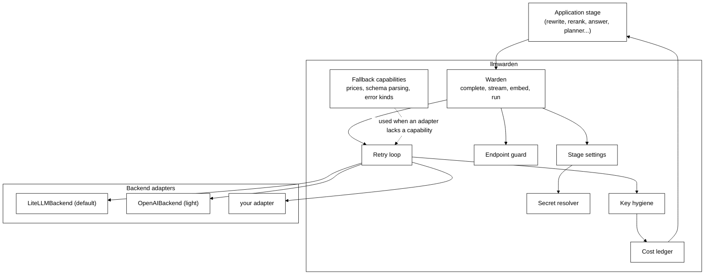
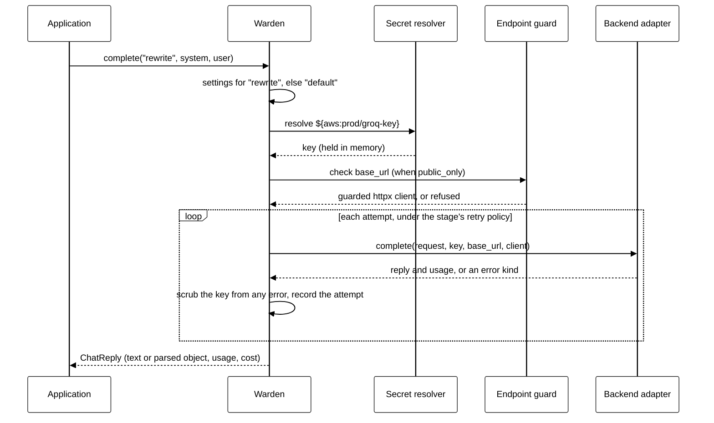

# llmwarden architecture

> **Status: proposal.** This describes the design before any code is written. Every claim about LiteLLM and the openai SDK below was checked against their source code and small probes with mocked HTTP. The versions are listed under [Evidence](#evidence).

## Goals

- One place where an application states, for each stage, which model, provider, key and endpoint it uses.
- Secrets fetched by reference from any store, never written into config, logs or errors.
- Safe custom endpoints on hosted apps.
- Structured output as validated Pydantic objects, and streaming, the same on every provider.
- Cost per run, per stage and per attempt, so retries are never hidden.
- Provider calls made by an existing library, which can be swapped.
- **Nothing rebuilt that the backend already does well.** Where a backend provides a capability, llmwarden uses it. Where it does not, llmwarden supplies its own.

## Non-goals

- Writing a client for each provider.
- Running as a proxy or gateway server.
- Deciding what an application's stages are or how they run.
- Load balancing across providers or keys.
- Storing cost records or deciding whether a run met its goal. The application does both; llmwarden hands it the records.

## The facade

llmwarden is a facade. Applications talk to one interface, `Warden`. Behind it sits one **backend adapter**, which wraps a provider library.



### The adapter interface

Every adapter implements the same small interface and declares what its library can do.

```python
@dataclass(frozen=True)
class Capabilities:
    providers: frozenset[str]   # providers this adapter can reach
    prices: bool                # can price a call itself
    schema: bool                # can ask the provider for schema-shaped JSON
    stream_usage: bool          # reports usage at the end of a stream
    http_client: bool           # accepts an injected httpx client per call
    embeddings: bool

class Backend(Protocol):
    capabilities: Capabilities

    def complete(self, request: ChatRequest, call: CallContext) -> ChatReply: ...
    def stream(self, request: ChatRequest, call: CallContext) -> Iterator[ChatChunk]: ...
    def embed(self, request: EmbedRequest, call: CallContext) -> EmbedReply: ...
    def error_kind(self, error: BaseException) -> ErrorKind: ...
    def price(self, reply: ChatReply | EmbedReply) -> Cost | None: ...   # used only if capabilities.prices
```

- `CallContext` carries what llmwarden resolved for this call: the key, the base URL, and, when the endpoint guard is on, the httpx client to use.
- Async versions (`acomplete`, `astream`, `aembed`) follow the same pattern.
- Every adapter is built with its own **constructor**, which takes that library's options, so an application can tune the library without llmwarden knowing about every option:

```python
warden = Warden.from_yaml("models.yaml", backend=LiteLLMBackend(drop_params=False))
warden = Warden.from_yaml("models.yaml", backend=OpenAIBackend(timeout=30))
```

### The rule: use the backend's, else ours

For each capability, llmwarden asks the adapter first. If the adapter's library provides it, the adapter hands it through. If not, llmwarden's own version fills in.

| Capability | LiteLLMBackend | OpenAIBackend | llmwarden supplies |
|---|---|---|---|
| Reach many providers | **Uses LiteLLM** (165 providers, `provider/model` names, `get_llm_provider`) | One: any OpenAI-compatible server | Nothing |
| Per-call key and base URL | **Uses LiteLLM** (`api_key`, `api_base` per call) | **Uses the SDK** (`api_key`, `base_url` on the client) | Nothing |
| Error kinds | **Uses LiteLLM's mapping** (every provider error mapped to one set, such as `RateLimitError` and `Timeout`), translated to ours with a small table | Maps the SDK's exception classes | The `ErrorKind` list the retry policy reads |
| Price of a call | **Uses LiteLLM** (`response_cost`, `completion_cost`, embeddings too) | None | A price table, used when the adapter has none or a stage sets its own price |
| Schema-shaped JSON from the provider | **Uses LiteLLM** (`response_format` takes a Pydantic class; `supports_response_schema`) | **Uses the SDK** (`chat.completions.parse` returns a parsed object) | Validation into the Pydantic class, always; a schema in the prompt for providers without support |
| Usage at the end of a stream | **Uses LiteLLM**, with `include_usage` always sent | **Uses the SDK** (`stream_options={"include_usage": True}`) | A flag when tokens were estimated, not reported |
| Injected HTTP client | **Uses LiteLLM** (`client=` per call; works on the OpenAI and Anthropic paths, other providers to be tested one by one) | **Uses the SDK** (`http_client=`) | The guarded client itself |
| Retries | Not used: LiteLLM's retries hide failed attempts (see Retries) | Not used: turned off with `max_retries=0` | The retry loop |
| Secret stores | Not used: LiteLLM's are bound to its proxy, need an enterprise licence, or are global | n/a | The secret resolver |
| Guard for custom endpoints | Not used: LiteLLM checks `api_base` only in its proxy | n/a | The endpoint guard |
| Key scrubbing | Not enough: LiteLLM callbacks receive the raw key | Not enough: SDK errors hold the key in `request.headers` | Key hygiene |
| Cost per run, per attempt | Not available in the SDK | n/a | The cost ledger |

## Components

### Stage settings

Loaded from YAML or built in Python. Each stage has:

| Field | Meaning |
|---|---|
| `model` | `provider/model`, for example `openai/gpt-5.4` or `groq/llama-3.3-70b-versatile`. llmwarden owns this format, and each adapter translates it. It matches LiteLLM's, so that adapter passes it straight through. |
| `api_key` | A secret reference such as `${env:GROQ_KEY}`. A literal key is allowed for local use and is masked when printed. |
| `base_url` | Optional. Any OpenAI-compatible server. Checked by the endpoint guard. |
| `params` | Optional model parameters: `temperature`, `max_tokens` and so on. |
| `price` | Optional price per million input and output tokens. Applied to this stage only. |
| `retry` | Optional retry policy (see Retries). |
| `fallback` | Optional model to move to after a failure. |

A stage with no entry, or an empty one, uses `default`. A stage that names no key uses the provider's standard variable through `env`, such as `OPENAI_API_KEY`.

When the settings load, each stage's provider is checked against the adapter's `capabilities.providers`. An unsupported provider fails then, not halfway through a run.

Settings are frozen once built. Changing them builds a new `Warden`, so a run in progress never mixes two sets of settings.

### Secret resolver

A reference has the form `${provider:path}`. The resolver looks up the provider by id and asks it for the value.

```python
class SecretProvider(Protocol):
    id: str
    def get(self, path: str) -> str: ...
```

- `env` is built in and reserved. It reads the process environment and, if given, a `.env` file.
- `aws`, `azure`, `vault` and `gcp` ship as extras, so their SDKs are installed only when used.
- An application registers its own with `warden.secrets.register(MyProvider())`.

**Why not LiteLLM's.** LiteLLM has secret manager integrations, but in the SDK they do not fit: Google, HashiCorp and CyberArk need its enterprise licence, the Azure Key Vault loader lives in the proxy, the AWS one works through global state, and `os.environ/` references are read only in Router config.

Values are resolved lazily, when a stage is first called, and held in memory for a configurable time (default: the life of the process). They are never cached to disk.

### Endpoint guard

Runs before any call, whenever a stage has a `base_url` and `public_only` is on.

1. The scheme must be `https`.
2. The URL must have no user info, no fragment and no query string.
3. The host is resolved, and every address must be public. Private ranges, loopback, link-local, multicast, reserved ranges and cloud metadata addresses are refused.
4. llmwarden builds an httpx client with **redirects off** and a transport that connects only to the address it checked, while keeping the real host name for TLS and the `Host` header. A DNS change between check and call cannot reach a private address.
5. That client is handed to the adapter through `CallContext`. LiteLLM takes it as `client=` and the openai SDK as `http_client=`. LiteLLM's async default transport is aiohttp, so the LiteLLM adapter sets `disable_aiohttp_transport` to keep the call on the guarded httpx client.

An adapter whose `capabilities.http_client` is false cannot pin the address. With `public_only` on, llmwarden refuses custom endpoints on that adapter rather than run them unguarded.

**Why not LiteLLM's.** LiteLLM's SDK never checks `api_base`. Its proxy does, and its `validate_url` helper guards image and file URLs. That helper is a useful reference, but it rewrites the URL to the IP, which breaks TLS host checks for https, so llmwarden pins the address in the transport instead.

With `public_only` off, as on a developer's own machine, local servers such as Ollama on `localhost` work.

### Key hygiene

- The resolved key goes to the adapter call and nowhere else. It is not stored on the stage settings.
- Any exception from the adapter is caught, its message scrubbed of the key, and re-raised as `ProviderError` with `from None`. The original is dropped because it can hold the key: the openai SDK's errors keep the real request, with the key in `request.headers`.
- llmwarden never registers LiteLLM callbacks and never passes their arguments on, because LiteLLM hands callbacks the raw key. Applications get llmwarden's own events and ledger records, which hold no key.
- `repr` and `str` of settings mask literal keys and show references as written.
- A logging filter is provided that scrubs any resolved secret from log records.

### Structured output

`complete` takes an optional Pydantic class and returns a validated instance of it:

```python
class Ranking(BaseModel):
    order: list[int]

reply = warden.complete("rerank", system=..., user=..., schema=Ranking)
reply.parsed      # a Ranking
reply.text        # the raw JSON the model returned
```

- If the adapter has `capabilities.schema`, the schema goes to the provider: LiteLLM's `response_format` takes the Pydantic class, and the openai SDK's `chat.completions.parse` takes it too.
- **llmwarden always validates the reply itself** with `model_validate_json`. LiteLLM returns a JSON string, not an object, and for a provider without schema support it either raises or, with `drop_params=True`, silently drops the schema. The LiteLLM adapter therefore never sets `drop_params`. For such providers, llmwarden describes the schema in the prompt instead.
- A reply that fails validation can be retried. If every attempt fails, `complete` raises `InvalidOutput` with the last raw text attached.

### Streaming

`stream` is a separate method, so `complete` stays simple:

```python
for chunk in warden.stream("answer", system=..., user=...):
    print(chunk.text, end="")
reply = chunk.final   # on the last chunk: full text, usage and cost
```

- Async: `astream`.
- `include_usage` is always sent. LiteLLM adds it on its own only for OpenAI's own endpoint, not for a custom base URL.
- When a provider reports no usage, LiteLLM estimates the tokens. llmwarden marks such usage as `estimated`, so the ledger never presents a guess as a count.
- `schema` is not accepted with `stream`. Structured output is validated on the whole reply.

### Retries

llmwarden runs retries itself, and the adapters turn every hidden retry off, so **every attempt is seen and recorded**. LiteLLM's own retries cannot be used for this:

- With `num_retries=2`, a probe made five HTTP attempts but LiteLLM reported one failure. When the first attempt failed and the second worked, it reported one success and no failure at all.
- Its retries rely on `tenacity`, which is not installed with LiteLLM. Without it, a sync call raises and an async call silently skips the retry.
- For OpenAI-based providers, LiteLLM and the openai SDK both retry twice by default, silently. The adapters always pass `max_retries=0`.

LiteLLM's Router does report each attempt, but it brings a large amount of machinery (deployments, cooldowns, caches) for one feature. A small loop is simpler.

Each stage has a retry policy: how many attempts, which `ErrorKind`s to retry (rate limit, timeout, server error, invalid output), and the wait between attempts. A retry can also move to the stage's `fallback` model.

### Cost ledger

Every attempt is one record:

| Field | Meaning |
|---|---|
| `run_id` | The application's own id for one unit of work, such as one question answered |
| `stage` | The stage name |
| `attempt` | 1 for the first try, 2 for the first retry, and so on |
| `model` | The model actually called, which differs from the stage's on a fallback |
| `outcome` | `ok`, `provider_error`, `invalid_output` or `cancelled` |
| `input_tokens`, `output_tokens` | As reported, or `None` |
| `usage_source` | `reported` or `estimated` |
| `cost` | From the price source, or `None` when a count or price is unknown |
| `price_source` | `stage`, `backend` or `llmwarden` |
| `seconds` | Wall-clock time of the attempt |

An application groups attempts into a run:

```python
with warden.run(run_id="q-1842") as run:
    answer_question(...)          # every stage call inside is recorded
run.succeeded()                   # the application says whether the run met its goal

run.cost()
# total:     0.0213
# useful:    0.0181   attempts whose outcome was ok
# wasted:    0.0032   failed attempts that still used tokens
# unknown:   1 attempt with no usage reported
# by stage:  rewrite 0.0009, rerank 0.0047, answer 0.0157
```

- **Failed attempts are counted.** A rate-limit or connection error usually returns no usage and costs nothing, so it shows as unknown, not zero. A reply that came back but failed validation did use tokens, and its cost is counted as wasted.
- **Success is the application's call.** llmwarden knows whether each call returned something valid. Only the application knows whether the run did its job, so it marks that with `run.succeeded()` or `run.failed(reason)`.
- **Storage is the application's call too.** The ledger is in memory. `run.records()` returns the rows, and an optional sink receives each one as it is written.

**Prices, in order:**
1. The stage's own `price`, applied by llmwarden to that stage only. It is never registered in LiteLLM, because LiteLLM's per-call prices are stored globally and leak into later calls to the same model.
2. The adapter's price, when it has one. For LiteLLM, `response_cost`. It is `None` for a model LiteLLM does not know, and llmwarden keeps it as unknown.
3. llmwarden's own table, for adapters without prices. It starts as a copy of LiteLLM's price file (MIT), with credit and the date it was taken.

The LiteLLM adapter sets `LITELLM_LOCAL_MODEL_COST_MAP=True`, so LiteLLM uses the price file inside the installed package and does not download one from GitHub when it is imported.

## One call, step by step



## Swapping the backend

The interface is kept small so that a new adapter is one file. Six things are kept on llmwarden's side, so a swap does not leak:

1. **Model names.** llmwarden owns `provider/model`, and each adapter translates it.
2. **Prices.** llmwarden owns the price order above, so an adapter without prices still gets costs.
3. **Errors.** Each adapter maps its library's exceptions to `ErrorKind`. The retry policy reads only `ErrorKind`.
4. **Provider coverage.** Each adapter declares its providers, and the settings are checked against them on load.
5. **The guarded HTTP client.** llmwarden builds it, and the adapter only accepts it. An adapter that cannot accept one gets no custom endpoints under `public_only`.
6. **Provider-specific features.** Some features, such as Claude's native citations, need request shapes a general adapter does not pass. These go through one marked escape hatch (see Open questions), so the normal path stays swappable.

**Two adapters from the first version.** `LiteLLMBackend` is the default. `OpenAIBackend` is a light adapter for any OpenAI-compatible server, built on the official `openai` SDK, for people who do not want LiteLLM's dependencies. The same contract tests run against both. With only one adapter, the interface would quietly come to depend on it.

**Writing your own adapter.** Implement `Backend`, declare its `Capabilities`, and pass it to `Warden`. Run llmwarden's contract test suite against it. Anything your library does not provide, leave out of `Capabilities`, and llmwarden supplies its own.

## Threats and how they are handled

| Threat | Handling |
|---|---|
| A key committed in a config file | Configs hold references. Literal keys are allowed only for local use and are masked when printed. |
| A user-supplied base URL reaches an internal service | Endpoint guard with `public_only`: https, public addresses only, the checked address pinned in the transport, no redirects. |
| A key appears in a traceback or log | Errors re-raised scrubbed with the original dropped, since SDK errors hold the request headers; logging filter. |
| A key reaches an application hook | LiteLLM callbacks are never registered or forwarded. llmwarden's events carry no key. |
| A key sent to the wrong server | The key goes only to its own stage's call. A custom endpoint with no key gets a placeholder, so an SDK never falls back to an environment key and sends it elsewhere. |
| Hidden retries cost money no report shows | Every library retry turned off; llmwarden's loop records each attempt. |
| A compromised or changed backend release | The backend is an extra pinned to an exact version and can be swapped. LiteLLM's price file is read from the package, not downloaded at import. |

## How the first two projects adopt it

- **RAG Playground (Pandion).** The rewrite, rerank and answer steps call `warden.complete` with their step name. Pandion's own provider list, key handling and endpoint guard are removed. Embedding can then use API models, not only local ones.
- **nl2sql.** Each agent maps to a stage. Its secret providers move into llmwarden. Because nl2sql runs on LangChain, llmwarden ships a small adapter, `llmwarden[langchain]`, that returns a LangChain chat model for a stage.

## Open questions

1. **Provider-specific features.** Should a stage be able to ask for the raw provider client, with the key still resolved and the endpoint still guarded? This is what Claude's native citations would need.
2. **First version scope.** Sync `complete` with `schema` and the cost ledger first, then `stream` and the async methods? Or all four together?
3. **Secret cache lifetime.** Is the life of the process the right default, or should keys expire, for rotation?

## Evidence

- **LiteLLM source:** commit `452ee4dc` on `main` (version 1.107.0 in `pyproject.toml`). LiteLLM is MIT licensed, except its `enterprise/` folder, which llmwarden does not use. The price file `model_prices_and_context_window.json` is MIT.
- **Probes:** litellm 1.105.1 (latest on PyPI at the time) and openai 2.54.0, with mocked HTTP only.
- **Main references:**
  - Error mapping: `litellm_core_utils/exception_mapping_utils.py:exception_type`.
  - Retries hiding attempts: `utils.py:client.wrapper` and `main.py:completion_with_retries`.
  - Cost: `cost_calculator.py:completion_cost` and `response_cost`.
  - Structured output: `utils.py:get_optional_params` and `supports_response_schema`.
  - Stream usage: `llms/openai/openai.py:get_stream_options`.
  - Injected client: `main.py:completion` (`client=`) and `custom_httpx/http_handler.py`.
  - `api_base` checked only in the proxy: `proxy/auth/auth_utils.py:check_complete_credentials`.
  - Raw key in callbacks: `litellm_logging.py:Logging._pre_call`.
  - The openai SDK: `_client.py:OpenAI.__init__`, `chat.completions.parse`, and `_exceptions.py:APIStatusError`.
